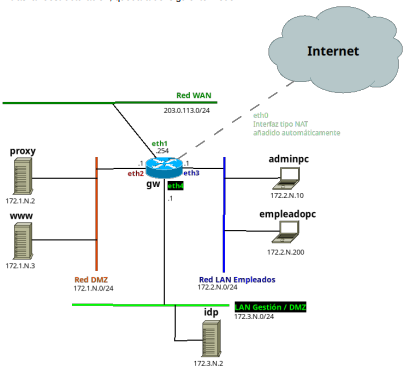

# IES CELIA
Proyecto de prueba de la clase de 2º ASIR, de María Isabel Rodríguez Valentín

## 1.Estructura
Un ejemplo de lo que vamos a realizar

## 1. Despliegue

1. Paso 1
2. Paso 2

Lista de viñetas:
